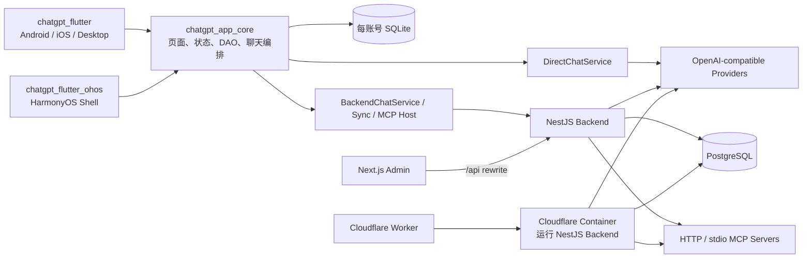

# 艾普（chatai_deep）

一个以 Flutter 为主客户端的全栈、多端 AI 应用 monorepo：同一套共享核心覆盖 Android、iOS、macOS、Windows、Linux，并提供独立 HarmonyOS 壳；服务端由 NestJS + PostgreSQL 提供鉴权、AI 代理、同步、MCP 与管理接口，另有 Next.js 管理后台。

项目最初来自 ChatGPT 课程工程，目前已扩展为包含普通 AI 对话、助手与长期记忆、Agent 工具调用、MCP、Skill 导入、本地 RAG、创作 / 酒馆、可恢复翻译任务、备份同步和发布安全门禁的综合工程。

> 当前常规 Flutter 壳版本为 `1.0.4+8`，固定 Flutter `3.35.7`；HarmonyOS 壳独立版本为 `1.0.0+1`。部分能力依赖 API Key、后端、第三方 MCP Server、真机或平台服务，代码已接入不等于当前机器已完成实网验收。

## 功能地图

| 领域 | 已实现内容 |
| --- | --- |
| AI 对话 | 16 家 OpenAI-compatible 服务商预设、自定义服务商与模型、会话级模型覆盖、本地直连 / 后端代理、流式输出、推理内容、图片 / PDF / 文件附件、联网搜索、用量与成本统计。 |
| 流式消息 | `StreamEvent` 将正文、思考、工具、引用、图片、文件、翻译、用量和错误转换为类型化 Block；`ChatBlockStore` 配合 `Selector` 缩小流式刷新范围。 |
| 助手系统 | 47 个内置模板、11 个分类；支持系统提示词、开场白、示例对话、模型 / 工具覆盖、角色卡、世界书、长期记忆和自定义 / Starcore 头像。 |
| Agent 工具 | 13 个内置工具；`ToolLoopRunner` 最多执行 5 轮。内置写工具、Skill 脚本和不受信任的非只读 MCP 工具先经用户确认；MCP 调用写入本地审计。 |
| MCP 与 Skill | 可直连 Streamable HTTP MCP，也可经 NestJS Host 聚合 HTTP / stdio Server；Skill zip 可把 `SKILL.md` 变成助手提示词、参考资料导入知识库、JS 脚本交给受限 QuickJS 运行时。 |
| 知识库 / RAG | 文本、PDF、图片导入，分块后保存到本地 SQLite；先做多词关键词检索，无命中时使用本地轻量向量回退，不依赖外部向量数据库或 embedding API。 |
| 创作 / 酒馆 | Story Room、角色卡 / CHARX、Tavern 导入导出、世界书高级匹配、群聊调度、Persona、Prompt、Quick Reply、受控 Regex、候选回复与故事分支、角色状态快照、创作资料与版本历史。 |
| 长任务翻译 | 角色卡与 Story Template 翻译支持模型选择、资格预检、受限 probe、分块 checkpoint、进度估算、重试 / 取消、账号隔离、前后台恢复和原子完成。 |
| 数据安全 | 按账号隔离的 SQLite、游客数据合并、备份格式 v11（含知识库、长期记忆、Story 数据和本地资源）、导入预览 / 完整性摘要 / 回滚、敏感字段脱敏。 |
| 云同步 | 已有 `/uapi/sync` 增量同步与冲突说明；Sync v2 的 shadow schema / outbox / inbox 已落地，但服务端仍由环境开关和用户白名单控制。 |
| 多媒体与体验 | 语音输入、系统 / 本地 TTS、图片生成相册、经典 / 二次元风格可逆切换、Starcore 导航 / 工具 / 助手头像和多平台应用图标。 |
| 管理后台 | Dashboard、用户、Banner、版本与 APK SHA-256、用量分析 / CSV、AI 服务商与模型、MCP、SMTP / 验证码 / 鉴权设置、内嵌 SSE AI Chat。 |

## 架构速览



Flutter 壳只负责平台启动、插件和发布差异；业务 UI 与数据逻辑集中在 `chatgpt_app_core`。Node 侧由根 `pnpm-workspace.yaml` 管理 backend 与 admin。普通聊天默认保存在客户端本地；后端 completion 接口记录 token usage，不会自动保存 Flutter 端完整消息。

一条流式消息的核心路径是：

```text
MessageInputWidget
  → ConversationPage
  → CompletionDao（历史、系统提示、附件、记忆、能力判断）
  → ToolLoopRunner → ChatService（工具路径）
    或 SearchOrchestrator → ChatService（联网搜索回落）
    或 ChatService（普通路径）
  → StreamEvent
  → StreamDispatcher
  → ChatBlockStore
  → BlockMessageContent + MessageDao
```

## 仓库结构

| 目录 | 职责 |
| --- | --- |
| `chatgpt_flutter/` | Android / iOS / desktop 壳；注入安全存储、发布渠道校验和 Story 翻译后台调度。 |
| `chatgpt_flutter_ohos/` | HarmonyOS 壳；用 OHOS-SIG fork 和本地 stub 适配插件。 |
| `chatgpt_app_core/` | 共享业务核心：页面、Provider、DAO、SQLite、聊天 / Agent / RAG / Story / 备份 / 同步。 |
| `chat_message/` | 独立聊天列表与气泡组件，基于 `ScrollablePositionedList`，向核心暴露滚动和头像扩展点。 |
| `openai_flutter/` | OpenAI-compatible 直连 SDK 与 SSE 解析。 |
| `login_sdk/` | 登录页、游客模式、`BackendConfig`、token storage 和登录 / 登出钩子。 |
| `auth_kit_flutter/` | 验证码、注册、密码登录、找回密码、第三方绑定等可复用 Flutter 鉴权组件。 |
| `hi_download/` | APK 下载、SHA-256 校验与原子保存。 |
| `chatgpt_backend/` | NestJS 11 + TypeORM + PostgreSQL 后端；包含 Auth、AI、Chat、MCP、Sync、Admin、Health。 |
| `chatgpt_admin/` | Next.js 16 + React 19 管理后台；HeroUI、Tailwind v4、TanStack Query、axios、Zod、RHF、Zustand。 |
| `cloudflare/backend/` | Worker → Cloudflare Container 转发、容器启动监督、migration 和 R2 持久上传配置。 |
| `ohos_stubs/` | OHOS 或 iOS Simulator 缺少原生实现时使用的 Dart-only stub。 |
| `chat_db/`、`flutter_network/` | 独立课程 demo，不是主应用依赖。 |

## 快速开始

### 1. 环境

- Flutter：`3.35.7`；推荐安装 FVM，并使用各包的 `.fvmrc`。
- Node.js：CI 使用 Node `22`。
- pnpm：根 `package.json` 固定 `10.12.4`。
- 后端：PostgreSQL；CI 使用 PostgreSQL `16`。
- Android：JDK `17`、compileSdk `36`、targetSdk `35`、NDK `28.2.13676358`。

如果本机全局 Flutter 已与 `.fvmrc` 一致，可以把下面的 `fvm flutter` 替换为 `flutter`。

### 2. 只运行 Flutter 客户端

```bash
cd chatgpt_flutter
fvm flutter pub get
fvm flutter run
```

首次进入可选游客模式，然后在「我的 → AI 服务设置」配置服务商、API Key、模型和「本地直连 / 后端代理」。游客模式适合本地直连体验；同步、AI catalog 等接口需要正式账号 JWT，后端共享 MCP 接口还要求管理员身份。普通用户可按自己的配置直连 MCP Server。

### 3. 启动 NestJS 后端

```bash
# 仓库根目录
pnpm install

# 仅首次初始化；已有 .env 不会被覆盖
test -f chatgpt_backend/.env || cp chatgpt_backend/.env.example chatgpt_backend/.env
```

先创建与 `DB_HOST / DB_PORT / DB_USER / DB_PASSWORD / DB_NAME` 匹配的 PostgreSQL 数据库和角色，再编辑 `.env`：至少要把示例 `JWT_SECRET` 和 `APP_SECRET_KEY` 换成两个不同的随机值（可分别运行 `openssl rand -base64 48`），并设置数据库参数。模板显式使用 `DB_SYNCHRONIZE=false`，所以新库必须先运行 migration；只有可随时丢弃的本地开发库才可主动改成 `DB_SYNCHRONIZE=true`，已有数据或生产库不要使用自动同步。

确认 `.env` 已编辑完成后再执行：

```bash
pnpm --filter chatgpt_backend run migration:run
pnpm backend:dev
```

生产部署由环境注入真实 secrets，不要原样复用开发 `.env`。先编译，再用编译产物执行 migration，最后启动：

```bash
pnpm --filter chatgpt_backend run build
NODE_ENV=production DB_SYNCHRONIZE=false \
  pnpm --filter chatgpt_backend run migration:run:prod
NODE_ENV=production DB_SYNCHRONIZE=false \
  pnpm --filter chatgpt_backend run start:prod
```

默认后端地址为 `http://localhost:3000`。`GET /healthz` 会执行 TypeORM 查询，证明 PostgreSQL 连通性，而不只是进程存活。

### 4. 启动 Next.js 管理后台

```bash
# 仓库根目录；先确保后端已启动
# 仅首次初始化；已有本地配置不会被覆盖
test -f chatgpt_admin/.env.local || cp chatgpt_admin/.env.local.example chatgpt_admin/.env.local
pnpm admin:dev
```

打开 `http://localhost:3001`。浏览器请求 `/api/*`，由 Next rewrite 到 `${NEXT_PUBLIC_BACKEND}/uapi/*`；`/uploads/*` 单独转发到后端静态资源目录。管理接口在服务端校验管理员身份：主应用使用 `AdminGuard`，auth-kit 的 `/uapi/admin/auth/*` 使用 `AuthKitAdminGuard`；`/uapi/auth/bind` 使用 `AuthKitJwtGuard` 校验登录身份。

### 5. HarmonyOS

```bash
cd chatgpt_flutter_ohos
eval "$(mise activate zsh --shims)"
fvm flutter pub get
# 将 api.example.com 替换为自己的后端域名
fvm flutter build hap --release \
  --dart-define=BACKEND_HOST=api.example.com \
  --dart-define=BACKEND_HTTPS=true
fvm flutter run \
  --dart-define=BACKEND_HOST=api.example.com \
  --dart-define=BACKEND_HTTPS=true
```

OHOS 使用独立 Flutter toolchain `flutter-oh-3.35.7`。启动时必须显式传入 `BACKEND_HOST`（仅主机名及可选端口，不含 scheme）；调试构建可使用可访问的 LAN 地址，release 构建要求公网 HTTPS 后端，并拒绝解析到本机或私网的地址。登录 token 和 AI 敏感设置通过 HUKS 安全存储插件保存；启动时执行写入、读回、删除探测，插件不可用时启动失败。

## 运行配置与安全边界

### AI 与后端地址

- AI Key 不再从源码文件读取，而是由 App 内「AI 服务设置」按账号保存。
- 常规壳为登录 token 和 AI 敏感设置注入平台安全存储，并以“写入后读回验证 + 脱敏普通副本”迁移旧数据。
- `BackendConfig` 优先级为：显式 setter → `--dart-define=BACKEND_HOST/BACKEND_HTTPS` → `LoginSdkConfig` → 自动探测。
- Android Emulator 自动使用 `10.0.2.2:3000`；真机需传入宿主机 LAN 地址或公网 HTTPS 域名。
- 本地直连会从客户端直接访问模型服务商；后端代理则把请求发往 `/uapi/chat/completions[/stream]`。

### 后端最小生产配置

生产至少需要正确配置 PostgreSQL、两个不同且足够长的随机值 `JWT_SECRET` / `APP_SECRET_KEY`、非默认 `ADMIN_DEFAULT_PASSWORD` 和 `CORS_ORIGINS`；即使某种启动方式有开发 fallback，也不能把 fallback 当生产配置，真实值不得提交 Git。SMTP、Apple / Huawei、AI seed、MCP 与 Sync v2 按启用功能补充。详细变量以 `chatgpt_backend/.env.example` 为准。

### 工具、MCP 与 Skill

- 本地写工具必须走 UI `confirm`；没有确认上下文时默认拒绝。
- 不受信任且非只读的 MCP 工具默认确认，并写入 `tb_tool_audit`。
- 后端共享 MCP Server 的工具目录、调用及连通性测试要求管理员身份；客户端直连 MCP 的权限由目标 Server 决定。
- Skill 的静态 / AI 审计只是辅助信号；真正边界来自 QuickJS 无文件系统、无网络、无进程 API，以及执行前确认。
- Skill JS 执行设有代码、输入、输出、时间及内存预算。当前仅在 Android / Windows / Linux 的 QuickJS 平台启用；iOS / macOS 的 JavaScriptCore 缺少所需堆内存限制，因此暂不启用脚本执行，Skill 提示词和参考资料导入仍可用。
- 外部网页、MCP 返回和导入文件都应视为不可信输入。

## 数据与存储

- `HiDBManager` 按账号 hash 打开独立 SQLite 文件；Windows 使用 `sqflite_common_ffi`。
- schema v2 表示旧 `tb_<cid>` 消息表迁入统一 `tb_messages` 的历史版本；当前还通过 `DbMigration` / `SchemaGuard` 集中补齐项目、知识库、用量、工具审计等 schema，各 Story / Memory DAO 负责自己的惰性表。
- `BackupService` 当前格式为 v11，覆盖普通会话、助手与记忆、收藏、项目、知识库、Story / Tavern 数据及头像、附件、生成图片、角色卡资源；导入前可预览，并校验 entry 摘要与资源边界。
- 普通云同步使用增量 push / pull、游标、墓碑和冲突说明；Sync v2 目前仍是受控 shadow，不能当作已全面切换的正式协议。

## 平台差异

| 能力 | Android | iOS | macOS / Windows / Linux | HarmonyOS |
| --- | :-: | :-: | :-: | :-: |
| 普通对话、助手、Story、文本知识库 | ✅ | ✅ | ✅ | ✅（共享核心） |
| 文件选择 / 导入 | ✅ | ✅ | ✅ | ❌（stub，入口隐藏） |
| 图片 / 扫描 PDF OCR | ⚠️ 默认 stub | ⚠️ 默认 stub | ❌ | ❌ |
| Skill JS 脚本 | ✅ | ❌ | Windows / Linux ✅；macOS ❌ | ❌（stub） |
| 系统 TTS / 分享面板 | ✅ | ✅ | 依平台插件 | 降级 / stub |
| 后台 Story 翻译任务 | WorkManager | BGProcessingTask | 前台恢复 | 无系统 worker |

OCR 插件本身只支持 Android / iOS，但 `chatgpt_flutter/pubspec.yaml` 当前为兼容 Apple Silicon iOS Simulator，把 `google_mlkit_text_recognition` 与 `pdfx` 都 override 到本地 stub，因此常规 Android / iOS 构建也默认没有 OCR。真机构建需要 OCR 时，删除该 override 并重新完成两端构建与运行验证。

## 验证与测试

主业务回归在 `chatgpt_app_core`，不是壳工程：

```bash
cd chatgpt_app_core
fvm flutter pub get
fvm flutter analyze --no-pub
fvm flutter test --no-pub --concurrency=1
```

常规壳与 Node 包：

```bash
cd chatgpt_flutter
fvm flutter pub get
fvm flutter analyze --no-pub
fvm flutter test --no-pub
fvm flutter build apk --debug --no-pub

# 回到仓库根目录
pnpm --filter chatgpt_backend test -- --runInBand
pnpm --filter chatgpt_backend run build
pnpm admin:typecheck
pnpm admin:build
```

当前仓库另有 package-level CI、PostgreSQL migration / Sync v2 并发测试、Cloudflare Container smoke、Android direct / store distribution contract 和离线 Android smoke。backend 的 e2e、migration 与 Sync PostgreSQL 测试需要匹配的数据库和环境变量。注意：backend 的 `lint` 脚本带 `--fix`，会修改文件；admin 的 `next build` 仍设置 `typescript.ignoreBuildErrors=true`，所以不能省略独立的 `pnpm admin:typecheck`。

## 发布与部署

- Android 默认 `direct` 渠道保留历史 `com.example.chatgpt_flutter` applicationId 和历史签名指纹，以维持旧用户覆盖升级；release task 会验证证书指纹。
- `store` 渠道必须显式提供正式 applicationId、keystore、公开 HTTPS backend，并通过 Gradle / Dart 双重校验；当前仓库不包含正式商店身份和密钥。
- 后端不是普通 Cloudflare Worker 运行时。仓库提供的是 Worker 入口 + Cloudflare Container + PostgreSQL + R2 持久上传方案，因为 NestJS、TypeORM、SMTP、Node 文件 API 与 stdio MCP 需要完整 Node.js 环境。
- 新建 direct 发布、修改 direct 的 URL / `versionCode` / channel，或清空已有摘要时，版本记录必须提供 64 位十六进制 SHA-256；store 渠道采用不同合同。客户端下载后会校验并原子保存。

## 文档导航

| 文档 | 用途 |
| --- | --- |
| [产品优化路线图](docs/product-optimization-roadmap.md) | 功能演进记录、已完成能力和后续优先级；篇幅较长，先看顶部状态。 |
| [助手工具路线图](docs/assistant-tools-roadmap.md) | 内置工具从 L1 到 RAG 的设计与实现记录。 |
| [Cloudflare 后端部署](docs/cloudflare-backend-deployment.md) | Container、PostgreSQL、R2、secrets、migration 和上线边界。 |
| [Flutter 迁移指南](docs/flutter-migration-guide.md) | Cherry Studio → Flutter 的历史迁移规格；其中 Riverpod / Drift 等早期设想不是当前实现。 |
| [Starcore 设计资产](docs/design-assets/starcore-guide/) | 图标、头像、生成 / 校验脚本与资产合同。 |
| [设计规格](docs/superpowers/specs/) / [实施计划](docs/superpowers/plans/) | 近期可靠性、发布与视觉系统的决策和验证记录。 |
| [分支评审导航](docs/branch-review.md) | 早期 block-message-system 分支的历史评审材料。 |
| [下一会话交接](docs/next-session-prompt.md) | 面向维护者的长会话 handoff，不是新人教程。 |

## 已知限制

- 鉴权使用数据库中的账号状态、角色和 `tokenVersion` 校验令牌；升级已有数据库需执行 migration，再验证密码重置、账号禁用及第三方绑定等真实登录流程。单元测试不能替代部署环境的接口验收。
- HarmonyOS 的 HUKS 插件与公网后端启动校验仍需在目标工具链和真机验证；Dart 测试通过不代表原生安全存储已验收。
- 外部 AI、搜索、MCP、SMTP、Apple / Huawei 登录、多设备同步和系统后台调度都需要相应环境，自动化测试不能替代真实账号、网络和设备验收。
- 知识库的向量回退是本地轻量算法，不等同于 embedding 模型 + 专用向量数据库。
- HarmonyOS 通过多个 stub 保持共享核心可编译，文件选择、OCR、JS、分享、TTS 等能力会隐藏或降级。
- Android direct 渠道保留历史示例 applicationId / 签名兼容合同；Store 正式身份仍需单独配置。
- Windows 图标目前可做静态资源合同校验；若当前开发机不是 Windows，不能据此宣称 Windows runner 已完成真实构建 / 启动验收。
