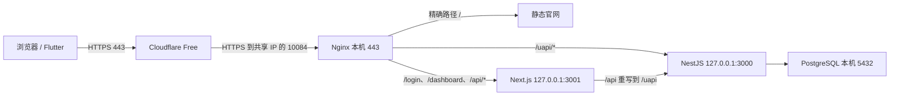

# 艾普部署实操：Ubuntu 2 核 2 GB、共享 IP、域名与 HTTPS

本文将 2026-10-18～19 本次对话中的部署过程整理成可复现教程：从只有 root SSH 登录的 Ubuntu 服务器开始，部署 NestJS API、Next.js 后台、PostgreSQL、产品官网与 Android 下载，再通过 Cloudflare Free 提供不带端口的 HTTPS。

**现有线上已经完成这些步骤。维护现有服务器请直接看第 12 节，不要从初始化重新执行。** 新服务器可按第 1～11 节依次操作；每节的“通过条件”满足后再继续。本文不会要求购买独立 IP、安装宝塔或 Docker。

后续已上线官方试用、邮件账号闭环、额度、反馈与灰度发布。当前客户端 `1.0.6+16` 提供官网下载，自动推送待真机验收；按架构构建、运营参数、验收与清理步骤见 [P0/P1 交付与验收](../../docs/p0-p1-delivery.md) 和 [客户端升级维护](../flutter/UPDATES.md)。本教程早期版本号与快照保留为历史证据，当前参数以上述交付记录和 [SERVER.md](SERVER.md) 为准。

## 0. 先看目标、参数和执行位置

最终入口：

| 用途 | 地址 |
| --- | --- |
| 官网 | <https://kushui.shop/> |
| 客户端下载 | <https://kushui.shop/#download> |
| 管理后台 | <https://kushui.shop/login>，`/admin` 为跳转别名 |
| API | `https://kushui.shop/uapi/*` |
| 健康检查 | <https://kushui.shop/healthz> |
| Flutter 后端 origin | `https://kushui.shop`，不带 `/uapi` 和端口 |



本次使用的参数如下。迁移到其它服务器或域名时，要同步替换 SSH、Nginx、Cloudflare、CORS、网站元数据、发布脚本和 Flutter 配置，不能只替换某一处。

| 参数 | 本次值 |
| --- | --- |
| 服务器 | Ubuntu 24.04、x86_64、2 核 2 GB |
| 共享公网 IP | `38.127.133.6` |
| 公网 SSH 映射 | `10072 → 本机 22` |
| HTTP TCP 映射 | `10083 → 本机 80` |
| HTTPS TCP 映射 | `10084 → 本机 443` |
| root 私钥（只在 Mac） | `~/.ssh/id_ed25519` |
| deploy 私钥（只在 Mac） | `~/.ssh/chatai_deploy` |
| 域名注册商 / DNS 托管 | GoDaddy / Cloudflare Free |
| 备用 HTTPS 网关 | `01a14fea704875d49fb78b48f2092eee.cn-hongkong-2.a8g1v3.xyz` |
| Node / pnpm | 部署脚本固定 `22.23.3` / `10.12.4` |
| Flutter | 项目 FVM 固定 `3.35.7`，以 `.fvmrc` 为准 |

共享 IP 的 80/443 不一定分配给这台实例。A 记录只能指定 IP，不能填写 `IP:10084`；普通 CNAME 也不能指定端口。本方案让客户端访问 Cloudflare 的 443，再由 Origin Rule 将回源端口改为 10084。Cloudflare Free 支持该端口覆盖，但客户端直接访问代理域名的 `:10084` 不受支持。[Origin Rules](https://developers.cloudflare.com/rules/origin-rules/)、[代理端口列表](https://developers.cloudflare.com/fundamentals/reference/network-ports/)。

本文标注 **Mac** 的命令在本地终端执行，标注 **Ubuntu root** 的命令在 root SSH 会话执行，标注 **网页** 的步骤在控制台完成。不要在 Mac 执行 `apt-get`、`systemctl` 或服务器安装脚本。Mac 需已有 `ssh`、`scp`、`curl`、Python 3；构建/测试 Flutter 还需项目对应的 FVM、Flutter 和 Android 工具链。

阅读顺序：

1. 配置 SSH 和 deploy 独立密钥。
2. 打包并上传源码。
3. 初始化 Ubuntu、部署 API/后台/数据库。
4. 用 SSH 隧道先验证后台。
5. 核对七牛共享 IP 映射。
6. 将 DNS 托管切换到 Cloudflare。
7. 申请源站证书并配置自动续期。
8. 安装 Nginx 公网配置与 CORS。
9. 发布官网和已验收的 Android 安装包。
10. 配置 Cloudflare 回源、跳转、缓存并启用代理。
11. 完成正常网络、浏览器和 Flutter 验收并清理。
12. 后续更新、备份与维护。
13. 按现象排查问题。

## 1. 配置 SSH 和 deploy 独立密钥

### 1.1 确认 root 可登录

**Mac：**

```bash
ssh -i ~/.ssh/id_ed25519 -p 10072 \
  -o IdentitiesOnly=yes root@38.127.133.6
```

第一次连接时，先通过服务器控制台等可信渠道核对主机指纹，再接受主机密钥。以后保留 known_hosts 校验；遇到指纹变化先核对实例是否重建，不使用 `StrictHostKeyChecking=no` 绕过。

**Ubuntu root：**

```bash
hostname
cat /etc/os-release
uname -m
free -h
df -h /
```

本次真实主机名为 `i-6ace0ac0820728a083805736`。能看到远端主机和 Ubuntu 信息，才算登录了服务器。

### 1.2 在 Mac 生成 deploy 专用密钥

另开一个 **Mac** 终端；保持刚才的 root 会话可用。

```bash
mkdir -p ~/.ssh
chmod 700 ~/.ssh
ssh-keygen -t ed25519 -a 100 -f ~/.ssh/chatai_deploy -C chatai-deploy
```

如果该文件已经存在，保留并复用，或换一个新文件名，不覆盖已有私钥。可设置私钥口令，并在本机通过 `ssh-add ~/.ssh/chatai_deploy` 加入 agent。后续如需无人值守，使用本机受控 agent 或专门的部署凭据方案。

`chatai_deploy` 是私钥，留在 Mac；`chatai_deploy.pub` 是公钥，上传服务器：

```bash
scp -i ~/.ssh/id_ed25519 -P 10072 -o IdentitiesOnly=yes \
  ~/.ssh/chatai_deploy.pub root@38.127.133.6:/root/chatai-deploy.pub
```

### 1.3 为 deploy 添加公钥

**Ubuntu root：**

```bash
if ! id deploy >/dev/null 2>&1; then
  adduser deploy
fi

install -d -m 700 -o deploy -g deploy /home/deploy/.ssh
touch /home/deploy/.ssh/authorized_keys
chown deploy:deploy /home/deploy/.ssh/authorized_keys
chmod 600 /home/deploy/.ssh/authorized_keys

if ! grep -qxF "$(cat /root/chatai-deploy.pub)" /home/deploy/.ssh/authorized_keys; then
  cat /root/chatai-deploy.pub >> /home/deploy/.ssh/authorized_keys
fi
rm /root/chatai-deploy.pub
```

本教程使用 root 做系统安装、deploy 做上传，**不需要给 deploy 配置免密 sudo**。给 deploy 添加密钥不会自动关闭它原来的密码登录，也不会修改 root 密钥。

**Mac：**验证必须使用公钥，不能悄悄回退密码登录。

```bash
ssh -i ~/.ssh/chatai_deploy -p 10072 \
  -o IdentitiesOnly=yes -o PasswordAuthentication=no \
  -o StrictHostKeyChecking=yes deploy@38.127.133.6
```

### 1.4 添加本机 SSH 别名

**Mac：**用编辑器打开 `~/.ssh/config`，保留原配置，添加：

```sshconfig
Host kushui-root
    HostName 38.127.133.6
    Port 10072
    User root
    IdentityFile ~/.ssh/id_ed25519
    IdentitiesOnly yes
    StrictHostKeyChecking yes
    ServerAliveInterval 30
    ServerAliveCountMax 3

Host kushui-deploy
    HostName 38.127.133.6
    Port 10072
    User deploy
    IdentityFile ~/.ssh/chatai_deploy
    IdentitiesOnly yes
    StrictHostKeyChecking yes
    ServerAliveInterval 30
    ServerAliveCountMax 3
```

```bash
chmod 600 ~/.ssh/config
ssh kushui-deploy 'hostname; whoami'
```

**通过条件：**最后输出远端主机名和 `deploy`。后续 `ssh kushui-root`、`scp 文件 kushui-deploy:~/` 都使用这些配置，不需要反复写端口和密钥路径。

## 2. 打包并上传源码

**Mac，仓库根目录：**

```bash
cd /Users/huangzhibin/AndroidStudioProjects/flutter/chatai_deep
CHATAI_STAGE=$(mktemp -d /tmp/chatai-deployment.XXXXXXXX)

python3 deploy/ubuntu/package.py source "$PWD" \
  "$CHATAI_STAGE/chatai-ubuntu-source.tgz"

COPYFILE_DISABLE=1 tar -czf "$CHATAI_STAGE/chatai-website.tgz" \
  website/index.html website/robots.txt \
  website/site-assets/site.css website/site-assets/site.js \
  website/site-assets/favicon.svg website/site-assets/release.json

scp "$CHATAI_STAGE/chatai-ubuntu-source.tgz" \
  "$CHATAI_STAGE/chatai-website.tgz" kushui-deploy:~/
```

源码包采用显式白名单，包含 backend、admin、pnpm workspace 和部署脚本；不需要先提交 Git。它排除了真实环境文件、密钥、依赖、构建缓存和 Flutter 工程。**网站和 APK 不在源码包内**，网站单独打包，APK 在第 9 节上传。不要用整个工作目录替代打包脚本。

**Ubuntu root：**首次解压到新的空目录：

```bash
mkdir /root/chatai-source
tar -xzf /home/deploy/chatai-ubuntu-source.tgz -C /root/chatai-source
tar -xzf /home/deploy/chatai-website.tgz -C /root/chatai-source
cd /root/chatai-source
```

**通过条件：**当前目录有 `pnpm-workspace.yaml`、`chatgpt_backend/`、`chatgpt_admin/`、`deploy/ubuntu/` 和 `website/`。如果目录已存在，先核对用途，更新部署应使用新的源码目录。

## 3. 初始化 Ubuntu 并部署后台服务

**Ubuntu root，`/root/chatai-source`：**

```bash
bash deploy/ubuntu/setup.sh
bash deploy/ubuntu/deploy.sh --source "$PWD"
```

`setup.sh` 安装 Ubuntu 依赖、PostgreSQL、Nginx、项目专用 Node/pnpm；在没有活动 swap 时创建 2 GB swap；生成独立 DB/JWT/加密主密钥/初始管理员密码。swap 要求根分区至少有 6 GB 可用空间，Btrfs 或已有自管 swap 时先阅读 [基础部署说明](README.md)，按需使用 `--skip-swap`。

`deploy.sh` 先串行构建 backend、admin 并独立检查 TypeScript，然后备份、执行数据库 migration、切换版本并启动 systemd 服务。应用运行账号是 `chatai`，不以 root 运行。服务器需能连接 Ubuntu 软件源、nodejs.org、npm registry。

```bash
systemctl is-active chatai-deep-api chatai-deep-admin nginx postgresql
curl --fail http://127.0.0.1:8080/healthz
ss -lntp
free -h
swapon --show
```

**通过条件：**四个服务 active；健康接口 200；API、admin、隧道入口分别监听 `127.0.0.1:3000`、`:3001`、`:8080`；数据库只供本机访问。

| 需要记住的路径 | 用途 |
| --- | --- |
| `/etc/chatai-deep/backend.env` | root 0600，实际密钥和生产配置 |
| `/opt/chatai-deep/current` | 当前应用版本的符号链接 |
| `/opt/chatai-deep/releases/` | 版本目录 |
| `/var/lib/chatai-deep/uploads` | 持久上传文件 |
| `/var/backups/chatai-deep/` | 数据库、uploads、配置的一致备份 |
| `/opt/chatai-deep/node/bin/node` | 应用专用 Node |

2 GB 构建发生 OOM 时，先检查 swap 和日志。可按 [外部 Linux 构建说明](README.md#更新与外部构建) 在同架构 Linux 构建后上传；不要上传 Mac 的 `node_modules`。

## 4. 先用 SSH 隧道验收后台

**Mac，单独终端并保持运行：**

```bash
ssh -N -o ExitOnForwardFailure=yes \
  -L 127.0.0.1:18080:127.0.0.1:8080 kushui-deploy
```

浏览器打开 <http://localhost:18080/login>。这条隧道把 Mac 的 18080 加密转发到服务器本机 8080，关闭该终端或按 Ctrl+C 就会断开。

**Ubuntu root：**只在自己的终端查看首次管理员凭据，不发到聊天、不截图或提交仓库：

```bash
grep '^ADMIN_DEFAULT_' /etc/chatai-deep/backend.env
```

使用管理员用户名和密码登录，确认仪表盘能加载。管理员用户名登录与 Flutter 的普通用户邮箱登录是两个入口。首次密码修改应由账号所有者在后台完成；修改 `ADMIN_DEFAULT_PASSWORD` 环境变量不会修改数据库里已有账号的密码。

**通过条件：**登录成功、仪表盘无接口报错；刷新保持登录；退出后受保护页面返回登录页。此时还只是 SSH 隧道验收，不能据此认定公网或手机可用。

## 5. 核对七牛共享 IP 和端口映射

**网页，七牛实例的公网访问/映射规则：**

| 类型 | 本机端口 | 本次公网 Endpoint | 用途 |
| --- | --- | --- | --- |
| TCP 端口映射 | 22 | `38.127.133.6:10072` | SSH |
| TCP 端口映射 | 80 | `38.127.133.6:10083` | HTTP 诊断/兼容入口 |
| TCP 端口映射 | 443 | `38.127.133.6:10084` | Cloudflare HTTPS 回源 |
| HTTP 代理 | 80 | 七牛分配的长域名 | 备用 HTTPS 网关、APK 下载 |

映射不存在时按上述本机端口创建，**公网端口以平台实际分配为准**。如果不是 10084，要同时修改后续 Origin Rule、Nginx 端口 map 和相关诊断命令。本次已有规则无需重复创建或删除。

HTTP 代理域名与 TCP 端口映射是不同入口。这里保留七牛自带网关作为大 APK 下载地址，自有域名通过 Cloudflare 接 TCP 10084，不依赖七牛 HTTP 代理绑定自定义域名。[七牛端口映射指南](https://developer.qiniu.com/las/13426/shared-public-ip-port-allocation-guide)。

## 6. 将域名 DNS 托管切换到 Cloudflare

### 6.1 GoDaddy 完成域名邮箱验证

**网页：**先确认注册邮箱验证已完成，GoDaddy 没有待验证/暂停解析提示。验证邮件使用最新的一封；链接报错时在控制台重发，不反复使用过期链接。

记录或导出现有 DNS，包括 A、CNAME、TXT、MX、CAA；已有邮件和第三方验证记录要一起保留。若原来启用了 DNSSEC，按 Cloudflare 的迁移说明先处理注册商的旧 DS，再更换 NS；站点 Active 后可重新配置匹配的 DNSSEC。[官方迁移步骤](https://developers.cloudflare.com/fundamentals/manage-domains/add-site/)。

### 6.2 在 Cloudflare 添加站点

**网页，Cloudflare：**添加 `kushui.shop`，选择 **Free**，核对扫描导入的 DNS：

| 类型 | 名称 | 内容 | 切换准备阶段 |
| --- | --- | --- | --- |
| A | `@` | `38.127.133.6` | DNS only，灰云 |
| CNAME | `www` | `kushui.shop` | DNS only，灰云 |
| CNAME/TXT/MX 等 | 原名称 | 原内容 | 按原用途保留；验证/邮件记录不代理 |

不要把 Cloudflare 公开解析返回的边缘 IP 填到根 A 记录，也不要给该实例添加不可用的 AAAA。A 内容始终是源站共享 IP。

### 6.3 在 GoDaddy 修改 Nameservers

Cloudflare 会分配两台 NS。本次为：

```text
edward.ns.cloudflare.com
mallory.ns.cloudflare.com
```

在 GoDaddy 的域名设置 → Nameservers/域名服务器中选择自定义，填写 Cloudflare **当前页面实际分配**的两台 NS 并保存。其它站点不一定分配这两台，不能照抄。本操作只迁移 DNS 托管，域名注册和续费仍在 GoDaddy。

**Mac：**

```bash
dig NS kushui.shop +short
dig @edward.ns.cloudflare.com kushui.shop A +short
```

**通过条件：**Cloudflare zone 显示 **Active**，权威 DNS 返回正确记录；如果本机递归解析仍显示旧 NS，应继续等待，不能只看权威查询就宣布所有用户已切换。等待期间仍用 SSH 隧道管理服务器。

## 7. 申请源站 HTTPS 证书并配置续期

Cloudflare 边缘证书保护“客户端 → Cloudflare”，源站 Let's Encrypt 证书保护“Cloudflare → 服务器”，两者都需要。共享 IP 无法直接使用标准公网 80 做本实例的 HTTP-01，所以使用 DNS-01。[Certbot Cloudflare 插件](https://certbot-dns-cloudflare.readthedocs.io/en/stable/)。

### 7.1 创建仅限本域名的 DNS 令牌

**网页，Cloudflare 用户资料 → API Tokens → Create Token：**

- 名称可用 `chatai-certbot-kushui-shop`。
- 权限只选 **Zone → DNS → Edit**。
- Zone Resources 只包含 **Specific zone → kushui.shop**。
- 设置合适到期日；本次为 **2027-10-19**，到期前需要轮换。
- 不使用 Global API Key；保存令牌时不要将它写进聊天、源码或命令参数。

这是 Certbot DNS 插件需要的最小域名范围与操作权限；不应为了省事授权所有域名。[插件凭据要求](https://certbot-dns-cloudflare.readthedocs.io/en/stable/#credentials)。

### 7.2 在服务器保存令牌

**Ubuntu root：**

```bash
apt-get update
apt-get install -y certbot python3-certbot-dns-cloudflare
install -d -m 700 /etc/letsencrypt/secrets
if [ ! -e /etc/letsencrypt/secrets/cloudflare.ini ]; then
  install -m 600 /dev/null /etc/letsencrypt/secrets/cloudflare.ini
fi
nano /etc/letsencrypt/secrets/cloudflare.ini
```

在编辑器内输入一行，将占位符替换为实际令牌：

```ini
dns_cloudflare_api_token = 在此填写实际令牌
```

```bash
chown root:root /etc/letsencrypt/secrets/cloudflare.ini
chmod 600 /etc/letsencrypt/secrets/cloudflare.ini
stat -c '%U %a' /etc/letsencrypt/secrets/cloudflare.ini
```

应输出 `root 600`。用编辑器经 SSH 写入可避免令牌出现在 shell 历史；本教程不要求把私钥或令牌拷回 Mac。

### 7.3 首次签发，或迁移已有证书的验证方式

**全新部署**在 Ubuntu root 执行以下命令，按 Certbot 提示填写自己的邮箱、阅读并确认服务条款：

```bash
certbot certonly --cert-name kushui.shop \
  --dns-cloudflare \
  --dns-cloudflare-credentials /etc/letsencrypt/secrets/cloudflare.ini \
  --dns-cloudflare-propagation-seconds 120 \
  -d kushui.shop
```

成功后应存在：

```text
/etc/letsencrypt/live/kushui.shop/fullchain.pem
/etc/letsencrypt/live/kushui.shop/privkey.pem
```

**如果沿用本次较早通过 GoDaddy 签发的现有正式证书**，不要重新签发或覆盖证书。只需在 DNS 已迁 Cloudflare 后执行下列配置迁移；它会先在 staging 演练，成功后保存新续期方式：

```bash
certbot reconfigure --cert-name kushui.shop \
  --authenticator dns-cloudflare \
  --dns-cloudflare-credentials /etc/letsencrypt/secrets/cloudflare.ini \
  --dns-cloudflare-propagation-seconds 120 \
  --non-interactive
```

两种情形选一种。当前线上已经完成迁移，不应为阅读本文而再执行 reconfigure。旧 GoDaddy hook/令牌仅保留为私有回滚资料，当前续期使用 Cloudflare。

### 7.4 安装 Nginx 续期后重载钩子

**Ubuntu root：**

```bash
install -d -m 755 /etc/letsencrypt/renewal-hooks/deploy
cat > /etc/letsencrypt/renewal-hooks/deploy/chatai-reload-nginx <<'SH'
#!/bin/sh
set -eu
/usr/sbin/nginx -t
/bin/systemctl reload nginx
SH
chmod 750 /etc/letsencrypt/renewal-hooks/deploy/chatai-reload-nginx
systemctl enable --now certbot.timer
certbot certificates
```

第 8 节 Nginx 安装成功后，再做第 11 节的续期演练。只创建 token 或启用 timer 不代表 DNS 验证和 reload 已经成功。

## 8. 安装 Nginx 公网入口、可信 CF IP 和 CORS

### 8.1 安装当前仓库模板

**Ubuntu root：**

```bash
cd /root/chatai-source
install -d -m 755 /etc/nginx/snippets
install -m 644 deploy/ubuntu/nginx-website-headers.conf \
  /etc/nginx/snippets/chatai-website-headers.conf
install -m 644 deploy/ubuntu/nginx-website-locations.conf \
  /etc/nginx/snippets/chatai-website-locations.conf
install -m 644 deploy/ubuntu/nginx-tls-port.conf \
  /etc/nginx/conf.d/chatai-deep-tls.conf
install -m 644 deploy/ubuntu/nginx-gateway.conf \
  /etc/nginx/conf.d/chatai-deep-public.conf
nginx -t
systemctl reload nginx
```

这里先安装 snippet，避免 TLS 模板 include 不存在的文件导致 Nginx 启动失败。官网 current 尚未发布时，根路径可能是 503；第 9 节发布完成后才应返回官网。

`nginx-gateway.conf` 的 `server_name` 是本次七牛长域名，换实例必须改成新分配的域名。文件内的 `server_names_hash_bucket_size 128` 是 http 级配置；若其它配置已定义同名指令，应合并保留一处，先解决 `nginx -t` 报错再 reload。

路由由 Nginx 分流：根 `/` 为官网；`/site-assets/` 为静态资源；`/uapi/`、`/healthz`、`/uploads/` 转到 API；后台其它页面与 `/api/` 继续交给 Next.js。Next.js 自己将 `/api/*` 重写为后端 `/uapi/*`，不需要改 admin 的 basePath。

### 8.2 只信任 Cloudflare 官方网段的真实 IP 头

**Ubuntu root：**下载官方 IP 列表，验证格式后生成 Nginx 配置，不直接信任任意来访者传入的 `CF-Connecting-IP`。

```bash
CHATAI_CF_IPS=$(mktemp -d /tmp/chatai-cf-ips.XXXXXXXX)
curl --fail --show-error --silent https://www.cloudflare.com/ips-v4 \
  -o "$CHATAI_CF_IPS/v4"
curl --fail --show-error --silent https://www.cloudflare.com/ips-v6 \
  -o "$CHATAI_CF_IPS/v6"

python3 - "$CHATAI_CF_IPS" <<'PY'
from pathlib import Path
import ipaddress, sys
root = Path(sys.argv[1])
networks = []
for name, version in [('v4', 4), ('v6', 6)]:
    values = (root / name).read_text().split()
    assert values, '官方 IP 列表为空，停止安装'
    for value in values:
        network = ipaddress.ip_network(value, strict=True)
        assert network.version == version and network.is_global
        networks.append(str(network))
content = ''.join('set_real_ip_from ' + n + ';\n' for n in networks)
content += 'real_ip_header CF-Connecting-IP;\nreal_ip_recursive on;\n'
(root / 'realip.conf').write_text(content)
PY

install -m 644 "$CHATAI_CF_IPS/realip.conf" \
  /etc/nginx/conf.d/chatai-cloudflare-realip.conf
nginx -t
systemctl reload nginx
```

IP 来源为 [Cloudflare 官方 IP 列表](https://www.cloudflare.com/ips/)。安装后保留正常的 Nginx/后端访问日志；日后 Cloudflare 更新网段时重新核对列表。

### 8.3 添加精确 CORS 来源

**Ubuntu root：**

```bash
nano /etc/chatai-deep/backend.env
```

编辑已有的 `CORS_ORIGINS=` 那一行，保留原有来源，加入正式根域名和实际使用的网关来源。例如本次可以包含：

```dotenv
CORS_ORIGINS=http://localhost:8080,http://127.0.0.1:8080,http://localhost:18080,https://kushui.shop,https://01a14fea704875d49fb78b48f2092eee.cn-hongkong-2.a8g1v3.xyz
```

不要重复添加同名配置键，也不要改 `DB_PASSWORD`、`JWT_SECRET`、`APP_SECRET_KEY` 或开启 schema synchronize。

```bash
python3 /root/chatai-source/deploy/ubuntu/config.py validate \
  /etc/chatai-deep/backend.env
systemctl restart chatai-deep-api
curl --fail http://127.0.0.1:8080/healthz
curl --fail --resolve kushui.shop:443:127.0.0.1 \
  https://kushui.shop/healthz
```

**通过条件：**Nginx 检查成功，两次 healthz 返回 200。第二次是保留域名/SNI 的本机源站 TLS 检查，只证明源站配置正确，不能当作普通公网客户端验收。

## 9. 发布官网和 Android 下载

### 9.1 确认 Flutter 正式地址

仓库中的 `deploy/flutter/production.json` 应为：

```json
{
  "BACKEND_HOST": "kushui.shop",
  "BACKEND_HTTPS": true
}
```

正式包通过 `--dart-define-from-file` 注入地址；开发默认地址保持原样。发布新 App 时使用第 12 节的构建流程。本节为复现本次发布，使用已经构建并验收产物内容的 **1.0.5+15** APK。

### 9.2 准备并校验本次 +15 安装包

**Mac，仓库根目录：**先检查本地已有产物：

```bash
ls -lh chatgpt_flutter/build/app/outputs/flutter-apk/app-release.apk
shasum -a 256 chatgpt_flutter/build/app/outputs/flutter-apk/app-release.apk
```

本次文件为 **304711031 字节**，SHA-256：

```text
b9cccc5802099905394e5d04ea462de71117d6f9a48f5d2dea3460878bd992a3
```

本地没有该文件时，可取回本次公开体验包。先下载到临时位置，不覆盖未知产物：

```bash
curl --fail --location --show-error \
  'https://01a14fea704875d49fb78b48f2092eee.cn-hongkong-2.a8g1v3.xyz/downloads/aipu-1.0.5-15-android.apk' \
  -o /tmp/aipu-1.0.5-15-android.apk
shasum -a 256 /tmp/aipu-1.0.5-15-android.apk
```

以下上传命令使用本地构建路径；若用了 `/tmp` 下载文件，把来源参数替换为该路径。**摘要必须与上述值一致**，重新构建出的不同内容不能冒用同一个不可变下载文件名。

```bash
scp chatgpt_flutter/build/app/outputs/flutter-apk/app-release.apk \
  kushui-deploy:~/aipu-1.0.5-15-android.apk
```

### 9.3 发布网站

**Ubuntu root：**

```bash
cd /root/chatai-source
bash deploy/ubuntu/publish-website.sh \
  "$PWD/website" /home/deploy/aipu-1.0.5-15-android.apk
```

脚本核对网站固定六个文件、APK 大小和摘要；把网站复制到独立 release，原子切换 `/var/www/chatai-website/current`，只读安装下载文件及摘要，备份并检查 Nginx，最后验证官网、API、后台。失败时尝试恢复原官网路由，不重建 API/admin。

当前发布脚本有本次 `kushui.shop`、七牛下载域名和 `+15` 文件名的显式校验。换域名、网关或包版本时，先按第 12 节同步这些值；不要跳过校验。

```bash
curl --fail --resolve kushui.shop:443:127.0.0.1 \
  https://kushui.shop/
curl --fail --head \
  https://01a14fea704875d49fb78b48f2092eee.cn-hongkong-2.a8g1v3.xyz/downloads/aipu-1.0.5-15-android.apk
```

**通过条件：**源站首页有产品正文；网关下载返回 200、附件头和正确文件大小。官网根路径与后台 `/login` 均保留，安装包不暴露目录列表。

## 10. 配置 Cloudflare 标准 HTTPS 并启用代理

**网页，Cloudflare 的 kushui.shop 站点：**先完成规则再开代理，避免请求误打共享 IP 的默认 443。

### 10.1 SSL/TLS

- Overview：选择 **Full (strict)**。
- Edge Certificates：启用 **Always Use HTTPS**，最低 TLS 1.2。
- 等待 Universal SSL 证书 **Active**，覆盖根域名和 `*.kushui.shop`。

Universal SSL 可以在 DNS-only 状态下准备；官方给出的常见签发窗口是 zone 激活后 15 分钟至 24 小时，以控制台 Active 为准。[Universal SSL](https://developers.cloudflare.com/ssl/edge-certificates/universal-ssl/enable-universal-ssl/)。

### 10.2 创建 Origin Rule

Rules → Origin Rules → Create rule（控制台入口名称可能调整）：

| 项目 | 填写值 |
| --- | --- |
| 名称 | `kushui-shared-ip-https-10084` |
| 匹配表达式 | `http.host eq "kushui.shop"` |
| Destination port / 回源端口 | Override to **10084** |
| Host header、SNI、DNS record | 保留原值，不覆盖 |

保存并启用。DNS 仍指向 `38.127.133.6`；Cloudflare 使用 `kushui.shop` 作为 Host/SNI，与源站根域名证书对应。[创建 Origin Rule](https://developers.cloudflare.com/rules/origin-rules/create-dashboard/)。

### 10.3 创建 www 到根域名跳转

Rules → Redirect Rules → Single Redirect：

- 匹配 `http.host eq "www.kushui.shop"`。
- 动态目标：`concat("https://kushui.shop", http.request.uri.path)`。
- 状态码 **308**。
- 勾选 **Preserve query string / 保留查询字符串**。

www 在边缘直接跳转，不回源；源站证书只有根域名也能使用。不要把 www 的请求转到只有根域名证书的源站再处理。

### 10.4 动态路径绕过缓存

Rules → Cache Rules，建立 `kushui-api-admin-no-cache`，Cache eligibility 选择 **Bypass cache**。至少覆盖 `/uapi/*`、`/api/*`、登录页和后台页面。本项目可以用以下表达式，把明确静态入口之外的路径都纳入：

```text
(http.host eq "kushui.shop" and not (
  http.request.uri.path in {"/" "/index.html" "/robots.txt"}
  or starts_with(http.request.uri.path, "/site-assets/")
  or starts_with(http.request.uri.path, "/_next/static/")
  or starts_with(http.request.uri.path, "/downloads/")
))
```

不用 Cache Everything 覆盖受保护接口；静态官网继续按 Nginx 返回的 Cache-Control 处理。不要为了验收关掉 Cloudflare 安全防护。

### 10.5 打开代理并等待普通解析更新

DNS Records 中将根 A 和 www CNAME 都改为 **Proxied / 橙云**，保留根 A 内容 `38.127.133.6`，其它验证/邮件记录仍按用途保留。

**Mac：**

```bash
dig A kushui.shop +short
curl --fail --show-error --connect-timeout 10 --max-time 30 \
  --dump-header /tmp/kushui-home.headers \
  --output /tmp/kushui-home.html https://kushui.shop/
```

**通过条件：**可信 TLS、HTTP 200、产品正文，响应头有 `server: cloudflare` 和 `CF-Ray`。打开后台前先完成这个无凭据检查。

如果控制台、权威 DNS 已更新，而 Mac 普通请求仍超时，先等待旧递归缓存失效。本次正是等普通缓存更新后才完成客户端验收；不要修改 hosts、关闭 TLS 校验、改系统代理，或把旧 GoDaddy 根 A 临时写成某个 Cloudflare 边缘 IP 来制造通过结果。

## 11. 完整验收与临时数据清理

### 11.1 官网、下载、API 路由

**Mac，仓库根目录：**若第 9 节取回的是 `/tmp` APK，将 `--apk` 参数替换为实际文件路径。

```bash
python3 deploy/ubuntu/verify-website.py \
  --apk chatgpt_flutter/build/app/outputs/flutter-apk/app-release.apk \
  --output /tmp/chatai-cf-website-verification.json
```

本次 **53/53** 通过，包括可信 HTTPS、CF 边缘、静态资源、后台页面、未登录 API 401、HTTP/www 跳转、查询保留、精确 CORS、API 不缓存、APK 大小/摘要/首尾 Range。

### 11.2 浏览器真实登录

用 Chrome 正常打开地址，逐项检查：

1. 官网首屏、场景切换、FAQ 展开、下载导航正常。
2. 下载区显示 Android Build 15、体验版、大小和 SHA-256 校验入口。
3. 在 `https://kushui.shop/login` 用既有管理员登录；不要用普通用户邮箱替代管理员用户名。
4. 仪表盘数据加载，刷新仍登录；保存不含凭据的官网/仪表盘截图。
5. 点击退出，再访问 `/dashboard` 应回到 `/login`。

不要把密码放 URL、截图或浏览器控制台。自动化需要临时传输既有凭据时，须有相应授权，使用 SSH 与 0600 文件，结束后删除；人工操作可直接从自己的受控终端读取并输入。

### 11.3 Flutter 普通用户登录

客户端邮箱密码登录走 `/uapi/auth/login/password`，不能使用后台 admin 用户名代替。SMTP 未配置时无法依赖验证码注册；可用附录 A 在数据库创建专用、可清理的临时普通用户，只用于登录验收。

**先按附录 A 创建脚本和用户，再在 Mac 执行：**

```bash
CHATAI_QA_DIR=$(mktemp -d /tmp/chatai-login-qa.XXXXXXXX)
scp kushui-root:/root/chatai-qa/qa-user.json "$CHATAI_QA_DIR/qa-user.json"
chmod 600 "$CHATAI_QA_DIR/qa-user.json"

cd /Users/huangzhibin/AndroidStudioProjects/flutter/chatai_deep/chatgpt_flutter
CHATAI_LIVE_CREDENTIALS="$CHATAI_QA_DIR/qa-user.json" \
  fvm flutter test ../login_sdk/test/production_backend_live_test.dart \
  --dart-define-from-file=../deploy/flutter/production.json \
  --no-pub --reporter expanded
```

首次在这台 Mac 使用项目时，需要先完成 FVM SDK 安装和 `fvm flutter pub get`，再用 `--no-pub`。本次公网集成用例 **1/1** 通过，覆盖 AuthDao 邮箱密码登录、令牌存储/公共请求头、受保护模型清单、普通用户管理接口 403 和清除登录态后 401。

**不论测试成功或失败，都执行清理，且不打印 qa-user.json 内容：**

```bash
ssh kushui-root '/opt/chatai-deep/node/bin/node --env-file=/etc/chatai-deep/backend.env /root/chatai-qa/qa.cjs cleanup'
rm "$CHATAI_QA_DIR/qa-user.json"
rmdir "$CHATAI_QA_DIR"
```

### 11.4 证书续期和服务状态

**Ubuntu root：**在 Nginx 配置已就绪后执行一次演练：

```bash
certbot renew --cert-name kushui.shop --dry-run --run-deploy-hooks
systemctl is-enabled certbot.timer
systemctl is-active certbot.timer
systemctl list-timers certbot.timer --no-pager
systemctl is-active chatai-deep-api chatai-deep-admin nginx postgresql
```

**通过条件：**staging 续期演练成功，TXT 能自动创建/清理，Nginx 检查和 reload 成功，timer enabled/active。staging 证书不能替换线上正式证书。

### 11.5 记录结果再结束

把正常公网、浏览器、Flutter、设备等结果分别记入交接文档。服务器 curl、强制解析诊断、Flutter 网络测试、手机真机测试是不同证据，不能互相替代。若用定时任务等待 DNS，全部验收后暂停该任务；服务器的 Certbot timer 必须继续运行。

本次最终记录：

| 验收项 | 2026-10-19 结果 |
| --- | --- |
| 服务器官网/下载 | 53/53 |
| 服务器管理员/API | 37/37 |
| 服务器普通用户与权限 | 5/5 |
| Mac 正常网络官网/下载 | 53/53 |
| Chrome 官网、后台登录/刷新/退出 | 通过，截图已保存 |
| 真实 Flutter 公网登录集成用例 | 1/1 |
| 自动续期 | dns-cloudflare staging 成功，timer 保留 |
| 临时账号与凭据 | 已删除，浏览器已退出验收登录态 |
| 等待 DNS 的自动任务 | `kushui-shop-https` 已 PAUSED |
| Android 真机、新地址原生 GUI | 未验收 |
| 真实模型推理、SMTP 邮件投递 | 未验收，需另行配置服务 |

客户端版本记录、旧包检测更新与自动检查的完整发布流程见 [客户端更新说明](../flutter/UPDATES.md)。只发布网站不等于已发布后台更新记录。

## 12. 后续更新、备份和维护

### 12.1 更新 backend/admin

先在 Mac 生成新的源码包，上传并在 Ubuntu 解压到新的空目录。进入新源码目录，执行：

```bash
bash deploy/ubuntu/deploy.sh --source "$PWD"
```

不要在 `/opt/chatai-deep/current` 直接改源码或 git pull。脚本复用现有数据库、密钥、uploads，构建成功后才停服务、备份和迁移。发生 migration/启动失败时，参考 [失败恢复](README.md#检查备份与失败恢复)；数据库已变更时不能只切回旧代码。

### 12.2 构建新的 Flutter 版本并更新网站

**Mac，仓库根目录：**先增加 `chatgpt_flutter/pubspec.yaml` 的 build number，再使用正式配置构建，例如下一版可用 `1.0.6+16`：

```bash
bash deploy/flutter/production.sh build apk --release
shasum -a 256 chatgpt_flutter/build/app/outputs/flutter-apk/app-release.apk
```

发布前同步以下文件，使用新文件名，不覆盖已有 +15：

| 文件 | 要同步的内容 |
| --- | --- |
| `chatgpt_flutter/pubspec.yaml` | 版本号和 build number |
| `website/site-assets/release.json` | version/build/bytes/sha256/url/backendOrigin 和实际签名/验收状态 |
| `website/index.html` | APK 与摘要链接、版本号、大小、体验/正式状态 |
| `deploy/ubuntu/publish-website.sh` | metadata URL 校验与 `filename` 的新版本文件名 |

运行网站发布脚本并重复第 11 节。当前包是 Android Debug 签名、包名 `com.example.chatgpt_flutter`；正式商店发布前按 [Android 发布签名](../../docs/android-release-signing.md) 配置并做设备验收。其它平台没有安装入口时应如实标注，不放不可用下载链接。

### 12.3 备份与日志

**Ubuntu root，在有部署脚本的源码目录：**

```bash
bash deploy/ubuntu/backup.sh
journalctl -u chatai-deep-api -u chatai-deep-admin -n 100 --no-pager
journalctl -u certbot.service -n 80 --no-pager
df -h /
free -h
```

备份脚本会短暂停止应用，完成一致备份后恢复原本运行的服务。完整备份应有 `COMPLETE`；用 `sha256sum -c SHA256SUMS` 和 `pg_restore --list database.dump` 检查，并在受控位置保留异机副本。数据库、uploads、`backend.env` 中的 `APP_SECRET_KEY` 必须对应，不能丢失密钥后只恢复数据库。

### 12.4 令牌轮换

本次 Cloudflare 续期令牌 **2027-10-19 到期**。到期前创建同等最小权限令牌，在服务器编辑 `cloudflare.ini`，保留 root 0600；执行第 11.4 节演练成功后，再撤销旧令牌。不要因为暂停了聊天自动任务就以为证书不再需要维护。

## 13. 常见问题定位

| 现象 | 先检查 | 处理方向 |
| --- | --- | --- |
| SSH Permission denied | 用户、10072、公私钥是否配对、authorized_keys 权限 | 用 `ssh -v kushui-deploy` 定位，不发送私钥或密码 |
| 隧道 bind 失败 | Mac 18080 是否被占用 | 换左侧本地端口，并同步浏览器地址 |
| IP 默认 80/443 超时 | 是否共享 IP，是否只分配高位 TCP 端口 | 保留共享 IP，核对映射与 CF Origin Rule |
| Nginx reload 失败 | `nginx -t` | 先修复证书路径、snippet、重复指令、端口冲突 |
| 502 | API/admin 服务状态、本机 healthz、日志 | 先修应用，不反复改 DNS |
| Cloudflare 522 | 根 A 内容、Origin Rule、10084 映射 | A 应为源站；确认回源端口不是共享默认 443 |
| Cloudflare 525/526 | 源站 TLS、证书域名/到期、SNI | 修源站并保持 Full (strict)，不降级 Flexible |
| www 失败 | 边缘证书覆盖、www 是否代理、Redirect Rule | 在边缘跳转，保留 path/query，不把 www 发往仅有根证书的源站 |
| 权威 DNS 正确、Mac 仍超时 | 普通递归缓存、本机代理 DNS 缓存 | 等传播后用正常网络重验；强制 IP 只算诊断 |
| Python urllib 返回 1010 | Cloudflare Browser Integrity Check、缺省 UA | 使用真实应用标识 `AipuDeploymentCheck/1.0`；不要伪装浏览器或关闭防护 |
| 登录后接口 401/403 | 普通用户/管理员入口、Bearer、角色 | 未登录 401、普通用户管理接口 403 本来就是预期结果 |
| App 仍连 :10084 | production.json、构建参数、实际安装版本 | 升级新地址 +15 或后续包；代理域名不接受客户端 10084 |
| 密码登录可用但收不到验证码 | SMTP 是否配置并完成投递验收 | 登录测试不能代替 SMTP 测试 |
| 官网发布拒绝 APK | release.json、大小、SHA、固定版本名 | 同步元数据，不能绕过校验或覆盖同版本不同内容 |
| 构建被 killed | `free -h`、swap、journalctl、磁盘 | 用同架构 Linux 外部构建，保留现有线上版本 |

## 附录 A：创建和删除 Flutter 专用临时验收用户

仅在独立测试流程需要邮箱密码账号、而 SMTP 尚未配置时使用；不要修改真实用户、管理员密码或角色。该脚本使用已部署 backend 的依赖和生产环境文件，在服务器 root 私有目录中生成 0600 凭据，创建后必须清理。

**Ubuntu root：**

```bash
install -d -m 700 /root/chatai-qa
cat > /root/chatai-qa/qa.cjs <<'JS'
const fs = require('node:fs');
const crypto = require('node:crypto');
const { createRequire } = require('node:module');
const backend = createRequire('/opt/chatai-deep/current/chatgpt_backend/package.json');
const { Client } = backend('pg');
const bcrypt = backend('bcryptjs');
const file = __dirname + '/qa-user.json';

async function main() {
  const db = new Client({
    host: process.env.DB_HOST, port: Number(process.env.DB_PORT),
    user: process.env.DB_USER, password: process.env.DB_PASSWORD,
    database: process.env.DB_NAME,
  });
  await db.connect();
  try {
    if (process.argv[2] === 'create') {
      if (fs.existsSync(file)) throw new Error('QA file already exists');
      const name = 'cfqa_' + crypto.randomBytes(8).toString('hex');
      const data = {
        baseUrl: 'https://kushui.shop', userName: name,
        email: name + '@example.invalid',
        password: crypto.randomBytes(24).toString('base64url'),
      };
      const hash = await bcrypt.hash(data.password, 12);
      const result = await db.query(
        'INSERT INTO users ("userName",password,email,role,"emailVerifiedAt") VALUES ($1,$2,$3,$4,NOW()) RETURNING id',
        [data.userName, hash, data.email, 'user'],
      );
      data.id = result.rows[0].id;
      fs.writeFileSync(file, JSON.stringify(data) + '\n', { mode: 0o600, flag: 'wx' });
      console.log('Temporary ordinary QA account prepared');
    } else if (process.argv[2] === 'cleanup') {
      const data = JSON.parse(fs.readFileSync(file, 'utf8'));
      const result = await db.query(
        'DELETE FROM users WHERE id=$1 AND email=$2 AND "userName"=$3 AND role=$4',
        [data.id, data.email, data.userName, 'user'],
      );
      if (result.rowCount !== 1) throw new Error('QA cleanup row count mismatch');
      fs.unlinkSync(file);
      console.log('Temporary QA account and server credentials removed');
    } else {
      throw new Error('Use create or cleanup');
    }
  } finally {
    await db.end();
  }
}
main().catch(() => {
  console.error('QA operation failed; credentials not logged');
  process.exitCode = 1;
});
JS
chmod 600 /root/chatai-qa/qa.cjs

/opt/chatai-deep/node/bin/node --env-file=/etc/chatai-deep/backend.env \
  /root/chatai-qa/qa.cjs create
```

随后按第 11.3 节取回凭据、运行测试并执行 `cleanup`。清理失败时保留 root 私有凭据，核对准确 ID 后再处理，不删除其它用户，也不要先丢掉凭据而留下无法定位的测试账号。此脚本是本次临时验收方法，不是向普通用户开放的注册机制。

## 附录 B：本次历程与其它文档的分工

本次实际经历了“无域名 SSH 隧道 → 七牛自带 HTTPS 网关 → 自有域名带 10084 端口 → Cloudflare 标准 HTTPS”。早期证书用 GoDaddy DNS 验证，迁移 DNS 后改用 Cloudflare 插件。首次复现可以直接使用本文的最终 Cloudflare 路线，不必先申请 GoDaddy API 令牌再迁移一次。

- [README.md](README.md)：基础安装脚本、资源限制、外部构建和失败恢复细节。
- [SERVER.md](SERVER.md)：当前真实服务器路径、服务、映射、续期与运维交接。
- [CLOUDFLARE.md](CLOUDFLARE.md)：当前 Cloudflare 配置、迁移验收和跨配置回滚边界。
- [WEBSITE.md](WEBSITE.md)：官网文件、下载版本、发布脚本与验收记录。
- [Flutter README](../flutter/README.md)：生产参数、启动/构建和各平台验收边界。

本文命令、脚本前置条件和平台官方说明已核对；它是对本次已完成部署的整理，编写本文没有重新初始化或修改线上服务，也没有新增生产账号、购买服务或提交/推送 Git。
